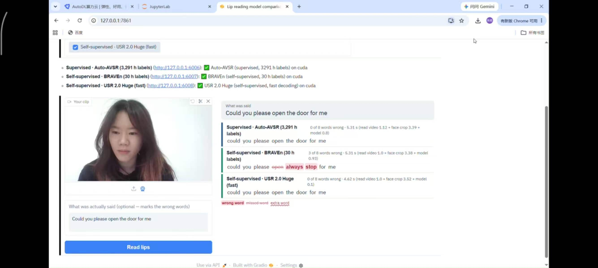

# Lip Motion to Text: A Reliable Lip-Reading Module for Robots

Master of Robotics and Automation Engineering, COMPSYS 792 Research Project (45 points)
University of Auckland, 2026 · Student: Peirou Zhang · Supervisor: Prof. Ho Seok Ahn

This project studies **visual-only speech recognition (VSR)**, or automatic lip-reading, for robots.
A robot needs a lip-reading module when the microphone fails (noise, distance, or a user who cannot speak aloud).
The project asks how to turn a benchmark VSR model into a module that a robot can trust:
how accurate public models are on new people, whether a model knows when it is wrong, and how to adapt it to a new user.



---

## Contents

1. [Project timeline](#1-project-timeline)
2. [Key results](#2-key-results)
3. [Repository layout](#3-repository-layout)
4. [Models](#4-models)
5. [Datasets](#5-datasets)
6. [Where to find each result](#6-where-to-find-each-result)
7. [How to run](#7-how-to-run)
8. [Demo GUI](#8-demo-gui)
9. [Limitations](#9-limitations)
10. [Upstream code and references](#10-upstream-code-and-references)

---

## 1. Project timeline

| Period | Stage | Main work |
|---|---|---|
| Semester 1 | Reproduction and deployment | Reproduced Auto-AVSR; built a BBC Tom Scott test set (91 clips); built the mouth-crop pipeline (RetinaFace + AWing, facexlib); built a remote inference server, a GUI and a webcam demo; tested AV-HuBERT, RAVEn and BRAVEn |
| Semester 2, part 1 | Benchmark | 29 configurations of 5 model families under one pipeline, with bootstrap confidence intervals, speed tests and 8 kinds of video damage |
| Semester 2, part 2 | Case Study A (one new speaker) | 302 min of Tom Scott YouTube video: confidence scoring, calibration, LLM correction, full fine-tuning, LoRA, threshold calibration, ROVER fusion, full system |
| Semester 2, part 3 | Case Study B (25 speakers in the wild) | 570 min of YouTube video (17 train / 8 test speakers): baseline, group fine-tuning, personal adaptation, confidence-based rejection, data audit |
| Semester 2, part 4 | Demo | Three-tab GUI (watch a clip, key findings, live webcam test) with three model services |

The original Semester 1 README (exact commands for the first reproduction, server and real-time demo) is kept in [`docs/README_semester1.md`](docs/README_semester1.md).

---

## 2. Key results

WER = word error rate (lower is better). LRS3 = full test set of 1,321 utterances unless marked LRS3-300 (fixed 300-utterance subset).

### 2.1 Benchmark (selected configurations)

| Model | Human-labelled data | LRS3 | BBC (91 clips) | s / clip |
|---|---|---:|---:|---:|
| USR 2.0 Huge (beam 40) | 433 h + pseudo-labels | **23.80** | 28.89 | 2.86 |
| BRAVEn Large low + self-training + LM (**B2**) | 30 h | 25.30 | 25.98 | 1.26 |
| BRAVEn Large low + self-training | 30 h | 26.03 | 26.06 | 0.94 |
| Auto-AVSR (**T1**) | 3,291 h (with auto labels) | 26.05 | **25.47** | 0.72 |
| Auto-AVSR | 1,759 h | 30.89 | 38.14 | 0.79 |
| RAVEn Large low + self-training | 30 h | 31.94 | 37.48 | 0.93 |
| Auto-AVSR | 438 h | 42.72 | 55.39 | 0.78 |
| AV-HuBERT Large (Semester 1, visual-only) | 433 h | 35.62 | 47.16 | – |

Main findings:
- **Self-supervised pre-training saves labels.** BRAVEn with 30 h of human labels matches Auto-AVSR with 3,291 h (26.03% vs 26.05%, paired bootstrap p = 0.99).
- **Self-training helps most.** −4.4 points for BRAVEn low-resource on LRS3. A language model gives −0.7 to −2.0 points on LRS3 but no reliable gain on BBC.
- **The best LRS3 model is not the best on a new speaker.** USR 2.0 Huge is best on LRS3 but about 3 points worse than T1 and B2 on BBC.
- **Frame drops hurt most, darkness least.** Freezing 50% of frames adds 20–31 points; half brightness adds no significant error for any model.
- **Short utterances are the hardest.** 1–3 word utterances have about 45–50% WER for the best models, against 13–17% for 16+ words.
- **Decoding matters for speed.** USR 2.0 Huge with greedy decoding takes 0.16 s per clip (18× faster than beam 40).

### 2.2 Case Study A: one new speaker (Tom Scott, 435 test clips)

| System | Tom Scott test | BBC | LRS3-300 |
|---|---:|---:|---:|
| T1 baseline | 32.27 | 25.47 | 25.16 |
| Full fine-tuning v2, 30 min | 38.91 | 32.10 | 32.11 |
| LoRA, 15 min (1.18 M parameters) | 30.06 | 23.94 | 27.14 |
| LoRA, all 257 min | 27.16 | 20.96 | 50.44 |
| **Full system** (LoRA + rejection + calibration) | **21.03** (82% kept) | **18.98** (91% kept) | – |

- Full fine-tuning made every test set worse. LoRA improved the target speaker at every data amount, but harmed other speakers beyond about 15 min, so it should be used as a personal adapter.
- Confidence (mean token log-probability) ranks errors well: Spearman −0.69 on LRS3-300.
- LLM correction (Qwen2.5-7B) gave at most −0.43 points and made high-confidence outputs worse.
- ROVER fusion of T1 and B2 gave little gain (31.96%), far from the oracle (27.64%), because the two models' confidences are on different scales.

### 2.3 Case Study B: 25 speakers in the wild (8 test speakers, 2,453 clips)

| System | 100% kept | 70% kept | 50% kept |
|---|---:|---:|---:|
| T1 | 69.62 | 61.92 | 57.14 |
| B2 | 65.46 | 57.72 | 53.99 |
| ROVER (T1 + B2) | 66.33 | 58.25 | 54.26 |

- B2 was better than T1 for all 8 test speakers.
- Group fine-tuning (69.84%, 70.19%) and personal adaptation (63.13–64.73% vs 61.44% baseline) did not help, most likely because YouTube automatic captions are noisy.
- Confidence-based rejection still worked: keeping the 50% most confident clips removes about 12 points of WER.
- Both models rank errors equally well (Spearman −0.76 for T1, −0.70 for B2), but T1 becomes overconfident in the wild (ECE 0.248, mean confidence 0.56 vs accuracy 0.31), while B2 stays close to calibrated (ECE 0.105).
- On 10 selected clips per speaker, B2 reached 38–40% WER for four common-accent speakers and 57–95% for Indian-English, Scottish, very fast speech and heavily edited video.

### 2.4 Live test (demo GUI)

Face detection and cropping take 60–80% of the processing time; the VSR model itself is fast (0.1 s for USR 2.0 Huge with greedy decoding). For real-time use on a robot, the pre-processing pipeline is the bottleneck.

> Note on Semester 1 numbers: the first reproduction reported 26.71% on LRS3 and 28.97% on BBC with the original Auto-AVSR `eval.py`. Semester 2 re-ran all models with one shared pipeline and text normalisation (numbers written as words), which gives 26.05% and 25.47% for the same checkpoint. All results in Section 2 use the Semester 2 pipeline.

---

## 3. Repository layout

```
.
├── README.md                    ← this file
├── UPSTREAM.md                  ← links to the third-party model code
├── docs/
│   ├── README_semester1.md      ← Semester 1 README (reproduction, server, real-time demo)
│   ├── design_report.docx       ← Semester 1 design report
│   └── images/gui/              ← GUI screenshots
├── scripts/  eval/  server/  gui/  realtime/
│                                ← Semester 1 code (data prep, eval logs, FastAPI server, first GUI, webcam demo)
└── thesis_export/               ← Semester 2 code, results and logs (copied from the AutoDL server)
    ├── vsr_bench/               ← main benchmark and adaptation code
    │   ├── common.py            ← shared paths, text normalisation and WER
    │   ├── models.csv           ← list of all model configurations
    │   ├── run_queue.py         ← runs the benchmark for all models in models.csv
    │   ├── eval_*.py            ← one evaluation script per model family
    │   ├── lora_adapt.py, adapt_autoavsr.py      ← LoRA and fine-tuning
    │   ├── calibrate_threshold.py, rover_combine.py, full_system_eval.py
    │   ├── perturb_rois.py, stats_bootstrap.py, make_figures.py
    │   ├── lipread_service.py, start_services.sh ← model services for the GUI
    │   └── gui/lip_compare_gui.py                ← demo GUI
    ├── day1/                    ← confidence scoring (conf_utils.py), per-clip results (conf/), figures (figs/)
    ├── results_v2/              ← benchmark results, one .meta.json per model and dataset
    ├── figures/                 ← benchmark tables and figures (table_main.csv, fig1–fig9)
    ├── adapt_lora/, adapt_v2/   ← training histories of LoRA and fine-tuning
    ├── results/                 ← Semester 1 summaries and Case B per-speaker results
    ├── demo/                    ← Case B rejection sweep (e8_results/), selected clips, data audit
    ├── tomscott/, speaker_clips/← clip-making and filtering scripts and manifests
    ├── logs/                    ← training and evaluation logs
    └── _large_files.txt         ← list of files too large for git (checkpoints, ROI caches)
```

---

## 4. Models

29 configurations from 16 checkpoints. Full list with settings: [`thesis_export/vsr_bench/models.csv`](thesis_export/vsr_bench/models.csv); full results: [`thesis_export/figures/table_main.csv`](thesis_export/figures/table_main.csv).

| Family | Training type | Labelled data | Size | IDs |
|---|---|---|---|---|
| Auto-AVSR | Supervised, with automatic labels | 23 h / 438 h / 1,759 h / 3,291 h | 250 M | S6, S0, S1, T1 (S2 = same model in VSR-ML code) |
| Ma et al. 2022 (VSR-ML) | Supervised | LRS3 or LRS2, ± LM | 53 M | S4, S4lm, S5, S5lm |
| RAVEn Large | Self-supervised | 30 h (low) / 433 h (high), ± ST, ± LM | 494 M | T4, R1, R2, R3 |
| BRAVEn Large | Self-supervised | 30 h / 433 h, ± ST, ± LM | 351–494 M | B1, T3, B2, B3, B4, B5 |
| USR 2.0 | Self-supervised + semi-supervised | 30 h / 433 h | 171–946 M | U1–U4, greedy (…g), beam 10 (U4b10) |

The case studies use **T1** (Auto-AVSR, 3,291 h, supervised) and **B2** (BRAVEn Large, 30 h labels, self-training, RNN LM weight 0.2).

---

## 5. Datasets

Videos, mouth crops and checkpoints are **not** in this repository (size and copyright). Only manifests, per-clip results and logs are included.

| Dataset | Size | Use | Notes |
|---|---|---|---|
| LRS3 test | 1,321 utterances | Benchmark | Public HuggingFace copy (re-encoded videos); LRS3-300 = fixed subset used in Case A |
| BBC Tom Scott | 91 clips | Out-of-domain test | Built in Semester 1; numbers in speech make text normalisation important |
| Tom Scott YouTube | 160 videos, 4,361 clips, 302 min | Case A | Split by video: train 3,712 / val 214 / test 435 clips |
| Multi-speaker YouTube | 25 speakers, 108 videos, 8,070 clips, 570.6 min | Case B | 17 train / 8 test speakers; labels are YouTube automatic captions |

---

## 6. Where to find each result

| Experiment | Files |
|---|---|
| Benchmark WER, speed, memory | `thesis_export/figures/table_main.csv`, `thesis_export/results_v2/*.meta.json` |
| Bootstrap confidence intervals and paired tests | `thesis_export/figures/stats_ci.csv`, `stats_pairs.csv` |
| Robustness (blur, low resolution, dark, frame drop) | `thesis_export/figures/stats_robustness.csv`, `fig6_robustness.png` |
| Error types, sentence length, confusions | `thesis_export/figures/error_*.csv`, `fig8_length_*.png`, `fig9_error_types.png` |
| Semester 1 four-model results (raw vs normalised WER) | `thesis_export/results/*_full_summary.txt` |
| Per-clip confidence (Case A and B) and N-best lists (Case A) | `thesis_export/day1/conf/*_confA.csv`, `*_nbest.jsonl` |
| Confidence ranking, tiers | `thesis_export/day1/figs/*_conf_summary.csv`, `tiers_summary.csv` |
| LLM correction | `thesis_export/day1/figs/llm_summary_*.csv` |
| Full fine-tuning | `thesis_export/logs/adapt_all.log`, `adapt_v2.log`, `thesis_export/adapt_v2/` |
| LoRA (5 min to all data) | `thesis_export/logs/lora_all.log`, `thesis_export/adapt_lora/` |
| Threshold calibration | `thesis_export/day1/figs/calibrate_results_T1.csv`, `calibrate_results_B2.csv` |
| ROVER fusion | `thesis_export/day1/figs/rover_results.csv` |
| Full system | `thesis_export/day1/figs/full_system_results.csv` |
| Reliability diagram | `thesis_export/day1/figs/reliability_diagram.png` |
| Case B baseline per speaker (E1) | `thesis_export/results/E1_T1_by_speaker.csv`, `E1_B2_by_speaker.csv` |
| Group fine-tuning (E2) | `thesis_export/logs/E2_T1_full*.log`, `E2v2_T1_eval.log` |
| Personal adaptation (E3) | `thesis_export/logs/E3_*.log` |
| Rejection sweep (E8) | `thesis_export/demo/e8_results/` |
| Selected clips and data audit | `thesis_export/demo/*_one_video.csv`, `ref_check.txt` |

---

## 7. How to run

All Semester 2 code was run on AutoDL (RTX 4090 / 5090), PyTorch 2.8, Python 3.12, CUDA 12.8, with the project root at `/root/autodl-tmp` (change `VSR_ROOT` or `common.py` if yours differs). The model code must be cloned first (see [`UPSTREAM.md`](UPSTREAM.md)).

```bash
pip install pytorch-lightning sentencepiece av facexlib scikit-image inflect omegaconf hydra-core torchmetrics jiwer
cd /root/autodl-tmp/vsr_bench
```

**1. Prepare mouth-crop caches**

```bash
python prep_lrs3_cache.py --parquet-dir /root/autodl-tmp/data/lrs3_test_hf/data
python prep_lrs3_cache.py --subset 300          # LRS3-300
python cache_bbc_rois.py                        # BBC set
python cache_tomscott_rois.py                   # Case A
python make_split.py                            # Case A train / val / test split by video
python prep_multispeaker_cache.py               # Case B
```

**2. Benchmark**

```bash
python run_queue.py --dry-run --datasets bbc    # print commands only
python run_queue.py --datasets lrs3 lrs3_300 bbc
python perturb_rois.py                          # robustness sets bbc_blur2, bbc_drop50, ...
python run_queue.py --datasets bbc_blur2 bbc_drop50 --ids T1 T3
python stats_bootstrap.py && python make_figures.py
```

**3. Confidence (N-best) for the case studies**

```bash
python eval_autoavsr_nbest.py --id T1 --ckpt <T1.pth> --dataset tomscott_test --limit 5   # quick test
python eval_autoavsr_nbest.py --id T1 --ckpt <T1.pth> --dataset tomscott_test
python eval_braven_nbest.py   --id B2 --ckpt <B2.pth> --lm <rnnlm.model.best> --dataset tomscott_test --gpu-decode
```

**4. Adaptation and the full system (Case A)**

```bash
python lora_adapt.py --minutes 15 --rank 8 --name L15
python adapt_autoavsr.py --minutes 5 --lr 1e-5 --freeze-layers 8 --anchor <weight> --name A5
python calibrate_threshold.py --model-id T1
python rover_combine.py
python full_system_eval.py
```

**5. Demo GUI**

```bash
bash start_services.sh                          # GPU server: starts the three model services
python gui/lip_compare_gui.py                   # local computer
```

Long runs were started with `nohup ... &`. Use `--limit 5` on any evaluation script to check the pipeline before a full run.

---

## 8. Demo GUI

| Tab | What it shows | Screenshot |
|---|---|---|
| Watch a clip | All models on the same LRS3 or BBC clip, wrong words marked | [`watch_clip_long.jpg`](docs/images/gui/watch_clip_long.jpg) |
| Key findings | Label efficiency, LRS3 vs BBC, speed, robustness | [`findings_*.jpg`](docs/images/gui/) |
| Live test | Webcam recording, three models (Auto-AVSR, BRAVEn without LM, USR 2.0 Huge greedy), time per stage | [`live_test_webcam.jpg`](docs/images/gui/live_test_webcam.jpg) |

---

## 9. Limitations

- All evaluation was offline on recorded video; the module has not yet been run on a physical robot or tested with users.
- The BBC set has only 91 clips, so differences below about 3 points on BBC are not reliable.
- LRS3 videos are re-encoded copies, so absolute WER is typically 5–7 points higher than published values.
- Case B labels are YouTube automatic captions, which mixes model errors with label errors.
- LoRA was only implemented for Auto-AVSR (T1).
- The ECE here uses clip-level accuracy (1 − clip WER), which is an adaptation of the usual definition.

---

## 10. Upstream code and references

Model code is not copied into this repository; see [`UPSTREAM.md`](UPSTREAM.md). Main references:

- Ma et al., *Auto-AVSR: Audio-visual speech recognition with automatic labels*, ICASSP 2023.
- Ma, Petridis, Pantic, *Visual speech recognition for multiple languages in the wild*, Nature Machine Intelligence 2022.
- Haliassos et al., *Jointly learning visual and auditory speech representations from raw data* (RAVEn), ICLR 2023.
- Haliassos et al., *BRAVEn: Improving self-supervised pre-training for visual and auditory speech recognition*, ICASSP 2024.
- Haliassos, Mira, Petridis, *Pay attention to CTC: Fast and robust pseudo-labelling for unified speech recognition* (USR 2.0), ICLR 2026.
- Shi et al., *Learning audio-visual speech representation by masked multimodal cluster prediction* (AV-HuBERT), ICLR 2022.
- Hu et al., *LoRA: Low-rank adaptation of large language models*, ICLR 2022.
